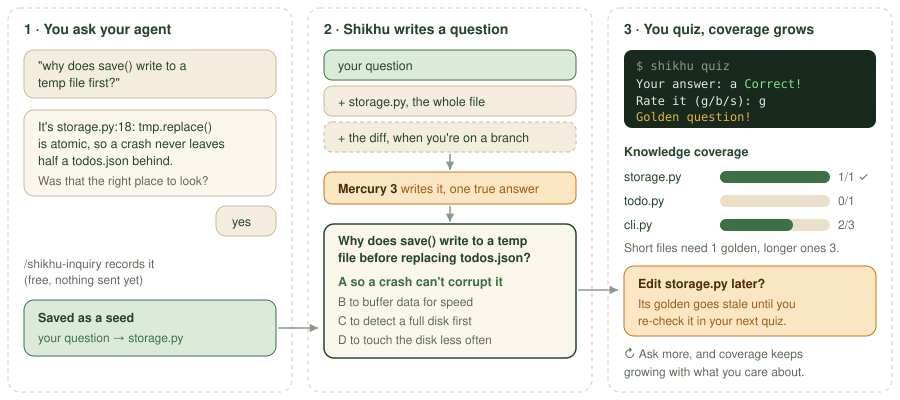
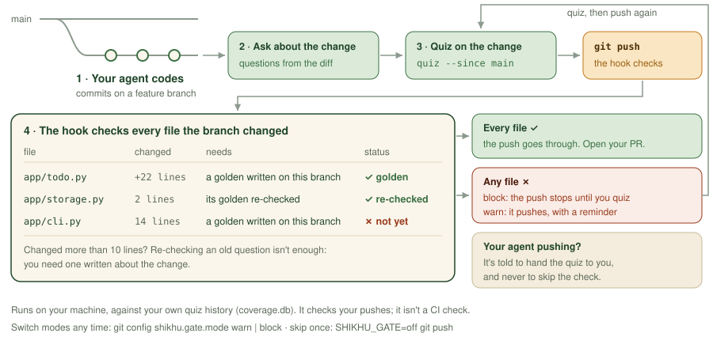

# Shikhu

[](https://github.com/arjunpatel7/shikhu/actions/workflows/ci.yml)

**Finally, understand the code your agents write. Measure, track, and update your knowledge coverage before every push. Fight comprehension debt, cognitive surrender and skill atrophy.**

Shikhu is a tool to help developers understand the codebases their agents write. Use Shikhu to measure your conceptual understanding of your codebase, and learn about changes made in branches. You can even include Shikhu during development to enforce knowledge checks, to prevent cognitive surrender, comprehension debt, and skill atrophy.

## Why Shikhu?

Agents write code faster than you can read it. You skim the diff, the tests pass, it ships, and a week later you can't explain how it works. That's comprehension debt, and it compounds with every feature.

Shikhu turns the questions you already ask your agent into short quizzes on your own code, and tracks which files you actually understand. That's your **knowledge coverage**. Think test coverage, but for your brain.

**What it's good for:**
- **Learning a codebase your agent built.** See where your questions have been, and quiz yourself on the files that matter.
- **Understanding every change before you ship it.** A git hook checks that you've been quizzed on what your branch changed, before you push.
- **Knowing where you stand.** Coverage shows which files you've proven you understand, and which you've never looked at.

**What's the catch?** A few minutes per PR, and a few cents for some LLM calls underneath. Wanna learn more? Grab an OpenRouter key and keep reading!

✍️ **[hero image: a real terminal quiz, or the push gate blocking then passing]**
> Use an absolute URL (`https://raw.githubusercontent.com/arjunpatel7/shikhu/main/docs/images/...`)
> so it also shows on PyPI, which renders this same file.

## The 60-second version
Get started quickly with an existing codebase. All you need is an OpenRouter key and a git repo. By the way, Shikhu works best inside Claude Code! Run `shikhu init` and `shikhu quiz` in your own terminal, since they ask you things, and let Claude handle the rest.

Navigate to your codebase and initialize Shikhu:

```bash
uv tool install shikhu
cd your-repo
shikhu init                          # asks for your OpenRouter key, and whether to check each git push
shikhu summarize                     # indexes your code (one cheap model call per file)
shikhu map                           # finds the questions you already asked Claude Code here, picks a file
shikhu generate-from-study <file>    # turns those questions into a quiz on the file map picked
shikhu quiz --file <file>
```

No Claude Code history in this repo? Swap the last three lines for `shikhu refresh`, then `shikhu quiz`.

**Check what you know, and where you should learn more**

Shikhu installs its skills, summarizes all the files in your codebase with Inception's fast Mercury diffusion model, and then uses Jev from TypeSafe AI to explore your previous conceptual queries. Each run costs a tiny amount of cents!

The map command allows you to see what you've already tried to learn about. Notice anything here? Try to improve your conceptual engagement by asking more questions about your code.

Then take the quiz. Answer a question right, rate it good, and confirm it really tests the file, and it becomes a **golden question**. Golden questions are what count toward your coverage.

Shikhu is designed to feel seamless and fit into existing development workflows. With the skill installed, continue building new features on branches, while asking questions and studying files. Your dev convos become fertile ground for review quizzes, which help benchmark your understanding. In other words, build the habit of learning while you code, without sacrificing the speed of agents.

## How it works



Every conceptual question you ask your agent about your code is a sign of what you care about. Shikhu keeps those questions, writes multiple-choice questions from them and your actual code, and quizzes you in the terminal.

- A **golden question** is one you answered right, rated good, and confirmed tests real understanding of the file.
- A file is **covered** at 3 golden questions, or 1 for files under 75 lines.
- Edit a file, and its golden questions go stale until you re-check them. Coverage stays honest as your code changes.

## Get started

**You'll need:**
- Python 3.12+ and [uv](https://docs.astral.sh/uv/) (or pipx/pip)
- An [OpenRouter API key](https://openrouter.ai/keys). A first run on a small repo costs about a cent. New OpenRouter accounts need a $5 minimum top-up.
- A coding agent that supports skills: Claude Code, Codex, Cursor, OpenCode
- Code in `.py`, `.js`, `.ts`, `.jsx`, `.tsx`, `.html` or `.css`. Other languages work with `--extensions` (see the [guide](https://github.com/arjunpatel7/shikhu/blob/main/docs/guide.md)).

### 1. Install and set up a repo

```bash
uv tool install shikhu
cd your-repo
shikhu init
```

`init` asks two things:
- **Your OpenRouter key** (typing is hidden). It's saved once in `~/.config/shikhu/.env`,
  readable only by you, and every repo uses it. A key in your shell or the repo's `.env` wins.
- **Check your understanding before each git push?** `w` warn, `b` block, or `s` skip
  (see [Ship with it](#ship-with-it)).

It also creates `coverage.db` (gitignored), a `.quizignore`, and installs three skills for your
agent: `/shikhu-inquiry`, `/shikhu-study` and `/shikhu`.

### 2a. An existing codebase

Follow [the 60-second version](#the-60-second-version). No Claude Code history? Two other ways in:

- Ask your agent about your code. `/shikhu-inquiry` answers and banks the question; then
  `shikhu generate-from-study <file>` and `shikhu quiz --file <file>`. Our favorite: the quiz is about what *you* wanted to know.
- Or `shikhu refresh` for general questions on every file, then `shikhu quiz`.

### 2b. A new project

Starting fresh? Perfect. Make sure your project is a git repo first (`git init`, before `shikhu init`, so it can install the push hook). Shikhu only reads files git tracks, so `git add` and commit as you build.

Been chatting with Claude Code in this folder already? Bring those conversations in, so the questions you already asked count:

```bash
shikhu summarize
shikhu map
```

From there, build with your agent as usual. Every push asks whether you've been quizzed on what changed, so you learn your codebase as it grows, one feature at a time.

## Ship with it



This is where Shikhu shines. By adding Shikhu to your dev workflow, you can ensure you take a bit of time to continue developing your understanding over time. Keep building with your agent, ask it about what it just changed, take a short quiz, then push.

```bash
# on your branch, after asking your agent about the change:
shikhu quiz --since main
git push
```

Asking `/shikhu-inquiry` about your change on a branch writes questions aimed at the diff
(`shikhu generate-from-study <file> --since main`). The hook checks that each changed file has a
fresh golden question:

| | warn | block |
|---|---|---|
| Not quizzed yet | pushes, and lists what you haven't been quizzed on | stops the push |
| Your agent is pushing | told to have you run `shikhu quiz --since main` | told not to skip it, and to hand the quiz to you |
| Switch | `git config shikhu.gate.mode block` | `git config shikhu.gate.mode warn` |

Skip once: `SHIKHU_GATE=off git push`. Add the hook later: `shikhu install-hook`.

The hook runs on your machine, against your local `coverage.db`, so it checks *your* pushes. It's not a CI check, and it doesn't block merges on GitHub.

## Your agent's skills

- `/shikhu-inquiry`: ask about your code; it answers with the files that matter and banks the
  question as a quiz seed. Often triggers on its own.
- `/shikhu-study <file>`: a guided walkthrough of one file.
- `/shikhu`: how to use Shikhu itself, and what to do when a push is blocked.

## Privacy

- Your quiz history lives in `coverage.db` in the repo, on your machine. It's gitignored.
- File contents go to OpenRouter (by default Inception's Mercury 3) to write summaries and
  questions, under your key. `.quizignore` keeps files out.
- `shikhu map` reads your local Claude Code transcripts for this repo, and sends past prompts
  to OpenRouter for scoring only after showing the cost and asking.

Details: [Privacy & data](https://github.com/arjunpatel7/shikhu/blob/main/docs/guide.md#privacy--data).

## Coming soon

- **Guides for your team.** Use these learnings to help others onboard quickly: turn your golden questions into a learning path for teammates.
- **A benchmark of your own knowledge.** Track it over time, and use it to compare agent setups.
- **Smarter quizzes.** Automatic checks that catch a flawed question before you ever see it.
- **No API key needed.** Sign in and go.

## More

- [The full guide](https://github.com/arjunpatel7/shikhu/blob/main/docs/guide.md): every command,
  how coverage works, configuration, `/shikhu-study`, `refresh`, other languages
- Love the repo and have some ideas? Open an issue! We aren't accepting PRs at this time.

## FAQ

**Why quizzes? Quizzes are boring!**
Yeah, I know, but quizzes are proven to actually develop understanding. They typically take a couple seconds to answer, and the tiny habit you form reviewing will slowly help build understanding.

Additionally, developing and maintaing quiz questions yourself while you use Shikhu is really neat. You are basically curating a validated benchmark/question set/onboarding guide over your own codebase as a byproduct of you working. That idea is really powerful, and one that I want to continue developing with Shikhu. Imagine being able to onboard teammates, or benchmark agents, using an up-to-date codebase specific assessment. Kinda neat!


**Why should I care? Won't agents know everything?**
This is super tempting to feel, but I believe that we can't give agents all the power here. Shikhu offers a path to maintain conceptual understanding (generally what the codebase does at a high level) while deferring specifics to agents. By maintaining conceptual, high level undertanding, you can more easily action on your codebase rather than throwing more tokens at the problem.

This actually makes you more efficient at using agents too! If you can precisely diagnose and articulate the problem, you can direct your agents much faster. Or, you can even estimate how well your agents know your codebase... compared to you!

**Who made this?**
✍️ [your words: who you are, why you built it, where to find you]

**How does Shikhu use Jev?**
Jev is TypeSafe's judgment model, which Shikhu calls through OpenRouter. Instead of writing text, it answers typed yes/no questions with a calibrated probability, so Shikhu can set a threshold instead of parsing an answer. It's used in three places:
- **`shikhu map`:** for each past prompt in your Claude Code history, Jev judges whether it was a question about this codebase, and how likely it is to be about each file. All the files are judged in one request, so it's cheap. The first run scores your whole history, later runs only new prompts, and each run stops at a $1 cap (`SHIKHU_JEV_BUDGET_USD`).
- **`/shikhu-inquiry`:** when you ask your agent a question, Jev first checks whether this repo can answer it at all, then scores each file, so the agent knows where the answer lives.
- **`shikhu generate-from-study`:** before writing new questions, Jev checks whether an unanswered quiz question already tests what you asked. If one does, that question moves to the front of your next quiz instead of getting a near-duplicate.

Jev sees your questions, past prompts, file summaries and quiz questions, never your source code.

**How does Shikhu use Mercury?**
Mercury 3 is Inception's diffusion language model: instead of writing one token at a time, it refines the whole answer in parallel, which makes it fast and cheap. Shikhu calls it through OpenRouter for two jobs:
- **Summaries** (`shikhu summarize`): a short summary of each file, cached and only redone when the file changes.
- **Quiz questions** (`refresh`, `generate-from-study`): written as structured JSON (a question, four choices, one answer) from your code and the questions you asked. The writer follows rules for exactly one true answer and similar-length choices, and on a branch it sees the diff so the questions are about your change.

Mercury is super super fast and cheap, so it's great for summarizing code and generating good questions.

You can point Shikhu at another model with `SHIKHU_MODEL` (experimental; it needs to support structured outputs).

<!--
DON'T-FORGET CHECKLIST (delete before merge)
- [ ] Hero image (absolute URL so PyPI shows it)
- [x] Both diagrams as committed SVGs in docs/images/, absolute URLs (they 404 until this merges to main)
- [x] Cost line: about a cent for a first run; $5 OpenRouter minimum top-up
- [x] Python 3.12+ (SHI-49)
- [x] Languages + --extensions (SHI-45)
- [x] Git-tracked files only (SHI-44), in 2b
- [x] map is Claude Code only, and what to do without history (SHI-46)
- [x] Not CI; skip once with SHIKHU_GATE=off
- [x] Privacy (short) + link
- [ ] After SHI-91 merges: the 60-second version can become "ask your agent → shikhu quiz"
- [ ] Every command here was run end to end on 2026-11-04 (fresh-install test). Re-check any you add.
-->
